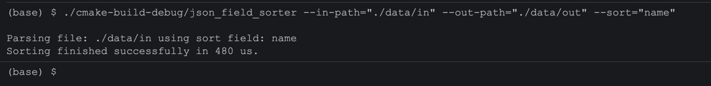
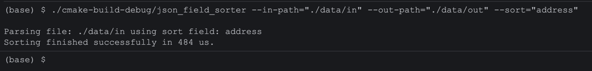
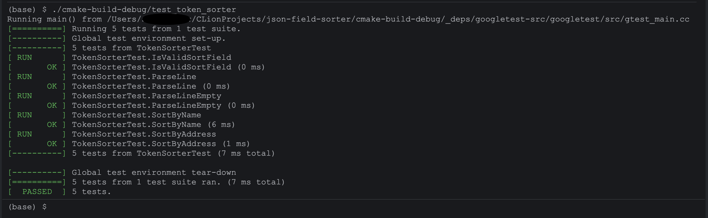

A simple JSON field sorting utility that sorts a given JSON file by name or address. Uses GoogleTest for
test automation.

## How to Build
_**Note:** This project requires a C++20-compatible compiler (e.g., GCC 10+, Clang 10+, Apple Clang 13+)._  
Project can be built either using CLion or standard CMake commands.

### Option 1: CLion (Recommended)
Open the project folder directly in CLion — it will automatically configure the CMake cache and download GoogleTest via `FetchContent`.

### Option 2: Command Line
Open your terminal, navigate to the project root folder, and execute the following commands:

1. **Generate the build files (Configure):**
   ```bash 
   cmake -B cmake-build-debug -S . -DCMAKE_BUILD_TYPE=Debug
   ```
- `-B` Specifies the build directory. CMake will generate all its build artifacts, Makefiles, or project files inside 
a folder named `cmake-build-debug`. If the folder doesn't exist, CMake will create it.
- `-S` Specifies the source directory. The dot (.) tells CMake to look for the root CMakeLists.txt file in your current 
working directory.
- `-DCMAKE_BUILD_TYPE=Debug` Sets the build configuration to Debug. This tells the compiler to turn off optimizations 
and include debug symbols so you can step through your code using a debugger (like GDB or LLDB). Other options include:   
`-DCMAKE_BUILD_TYPE=Release` - Turns on full compiler optimizations (usually -O3) and removes debug symbols. t makes 
your program run as fast as possible and keeps the executable file size small.
- `-DCMAKE_BUILD_TYPE=RelWithDebInfo` - Turns on optimizations (usually -O2) but keeps the debug symbols. This is the 
best choice if you want maximum speed but still need to read crash logs, generate stack traces, or profile your code's 
performance.
- `-DCMAKE_BUILD_TYPE=MinSizeRel` - Optimizes the code specifically for size (usually -Os) rather than speed. Ideal for 
embedded systems or environments where storage space is highly limited.

2. **Compile the binary targets:**
   ```bash
   cmake --build cmake-build-debug
   ```

To switch to a standard Release build, change the flag like this:
```
cmake -B cmake-build-release -S . -DCMAKE_BUILD_TYPE=Release
cmake --build cmake-build-release
```

## Example Input JSON File

```
{"name":"hoge.finance","address":"0xfAd45E47083e4607302aa43c65fB3106F1cd7607"}
{"name":"DuckDaoDime","address":"0xFbEEa1C75E4c4465CB2FCCc9c6d6afe984558E20"}
{"name":"Moss Carbon Credit","address":"0xfC98e825A2264D890F9a1e68ed50E1526abCcacD"}
{"name":"Rarible","address":"0xFca59Cd816aB1eaD66534D82bc21E7515cE441CF"}
{"name":"Reef.finance","address":"0xFE3E6a25e6b192A42a44ecDDCd13796471735ACf"}
{"name":"Amp","address":"0xfF20817765cB7f73d4bde2e66e067E58D11095C2"}
{"name":"FalconSwap Token","address":"0xfffffffFf15AbF397dA76f1dcc1A1604F45126DB"}
```

## Run Binary
First navigate to the project root folder:

```bash
cd json-field-sorter
```

### 1. Sort By Name
```bash
./cmake-build-debug/json_field_sorter --in-path="./data/in" --out-path="./data/out" --sort="name"
```


### 2. Sort By Address
```bash
./cmake-build-debug/json_field_sorter --in-path="./data/in" --out-path="./data/out" --sort="address"
```


## Run Tests

Execute the compiled test binary from the project root to trigger the GoogleTest verification suite:
```bash
./cmake-build-debug/test_token_sorter
```
